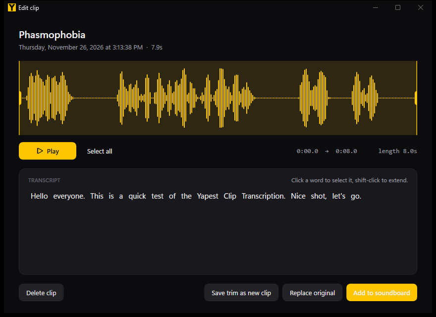

<p align="center">
  
</p>

<h1 align="center">Yappest</h1>

<p align="center">
  Free voice changer, soundboard and audio clipper for Windows 10 and 11.<br>
  One virtual microphone, <b>Yappest Input</b>, carries your voice, your effects and your sounds.
</p>

<p align="center">
  <a href="https://github.com/11fanatic11/yappest.fanaticdev.xyz/releases/latest/download/Yappest-Setup.exe"><b>Download for Windows</b></a>
  &nbsp;·&nbsp;
  <a href="https://yappest.fanaticdev.xyz">yappest.fanaticdev.xyz</a>
</p>

---

## What it does

**Voice changer.** Eight voices, each with its own controls: Pitch, Sound Barrier (loud and wrecked, and it breaks apart when you scream), Robot, Demon, Cavern, Radio, Alien and Whisper.

**Soundboard.** Add mp3, wav, ogg or mp4 (the audio is pulled out of videos). Name your sounds, give them icons (png, jpg, webp, gif), organise them in boards, and play them from the app, a shortcut or a Stream Deck.

**Clipping.** Press a key and Yappest saves the last 5 to 60 seconds of your microphone and your PC's audio as an mp3, labelled with the date, time and the game you were in. Clips are transcribed on your PC, so you can trim by clicking words, then turn the trim into a soundboard sound. A small toast slides in at the top right when a clip is saved.

**Stream Deck.** Play sounds, clip, mute your mic, switch voices and more, through a plugin that talks to Yappest over a local socket.

**Everything else.** Global shortcuts (single keys work too), mic mute from the app, tray or Stream Deck, runs quietly in the tray at startup, a theme colour you can change, and optional updates that only install when you say yes.

<p align="center">
  
</p>

## Install

Download `Yappest-Setup.exe` from the [latest release](https://github.com/11fanatic11/yappest.fanaticdev.xyz/releases/latest). It installs for your user account and needs no admin rights. The first time Yappest runs, Windows asks for permission once so it can set up the Yappest Input microphone.

Then choose **Yappest Input** as the microphone in Discord, your games, OBS or anything else.

## How it works

```
mic ─► gain / mute ─► voice changer ─┬─► virtual audio cable ─► appears to apps as "Yappest Input"
                                     ├─► your headphones (Hear myself)
                                     └─► 60 s buffer ─┐
soundboard ─► Yappest Input + your headphones         ├─► clip ─► mp3 ─► Whisper transcript ─► trim editor
system audio (WASAPI loopback) ─► 60 s buffer ────────┘
```

- `src/Yappest/Audio`: the engine, the eight voices (`Effects.cs`), mixer and device helpers.
- `src/Yappest/Services`: clip recorder, speech-to-text, game detection, global hotkeys, the Stream Deck socket, the updater, virtual cable setup and the Voicemod importer.
- `src/Yappest/UI` and `Pages`: windows and screens. The accent colour is in `ThemeService`.
- `streamdeck/com.yappest.sdPlugin`: the Stream Deck plugin (plain HTML and JavaScript, no dependencies).

Speech recognition runs entirely on your PC with [whisper.cpp](https://github.com/ggerganov/whisper.cpp) through [Whisper.net](https://github.com/sandrohanea/whisper.net). Nothing you record is uploaded.

## Build from source

You need the .NET 8 SDK and, for the installer, [Inno Setup 6](https://jrsoftware.org/isinfo.php).

```powershell
dotnet run --project src\Yappest                       # run it
powershell -ExecutionPolicy Bypass -File build.ps1     # build the installer (see vendor\README.md first)
```

Set `YAPPEST_DATA` to a folder to run against a throwaway profile. `Yappest.exe --selftest` runs headless checks on the voices, clips and Stream Deck socket.

The Stream Deck socket listens on `127.0.0.1:59712` only. See `StreamDeckServer.cs` for the messages.

## Updates

Yappest reads a small `update.json` from [yappest.fanaticdev.xyz](https://yappest.fanaticdev.xyz) when it starts. If a newer version exists it asks; nothing downloads until you press Update. Downloads are verified against a SHA-256 checksum and only accepted from GitHub or `fanaticdev.xyz`. Turn it off in Settings.

## License

Yappest is source-available under the [PolyForm Strict License 1.0.0](LICENSE). In plain English:

- You can read the code, build it, and use it for non-commercial purposes.
- You can't redistribute it, publish copies, or make and share modified versions.
- You can't use it commercially.

This is not an "open source" license in the OSI sense, because open source requires the right to redistribute. The Yappest name and logo aren't licensed for any use outside this project. GitHub's terms still let people view and fork public repositories on GitHub itself.

If you'd like to use Yappest in a way the license doesn't cover, get in touch first.

## Credits

Yappest's virtual microphone is built on [VB-CABLE](https://vb-cable.com), a donationware virtual audio device by VB-Audio Software (donations to VB-Audio are welcome). Yappest isn't affiliated with or endorsed by VB-Audio.

Built with [NAudio](https://github.com/naudio/NAudio) (audio), [Whisper.net](https://github.com/sandrohanea/whisper.net) and [whisper.cpp](https://github.com/ggerganov/whisper.cpp) (speech recognition), the LAME MP3 encoder through [NAudio.Lame](https://github.com/Corey-M/NAudio.Lame), [SkiaSharp](https://github.com/mono/SkiaSharp) (images) and [DiscordRichPresence](https://github.com/Lachee/discord-rpc-csharp). Game names come from Discord's public detectable-applications list. Stream Deck is a trademark of Elgato. Each project keeps its own license.

---

<p align="center">© 2026 Fanatic</p>
